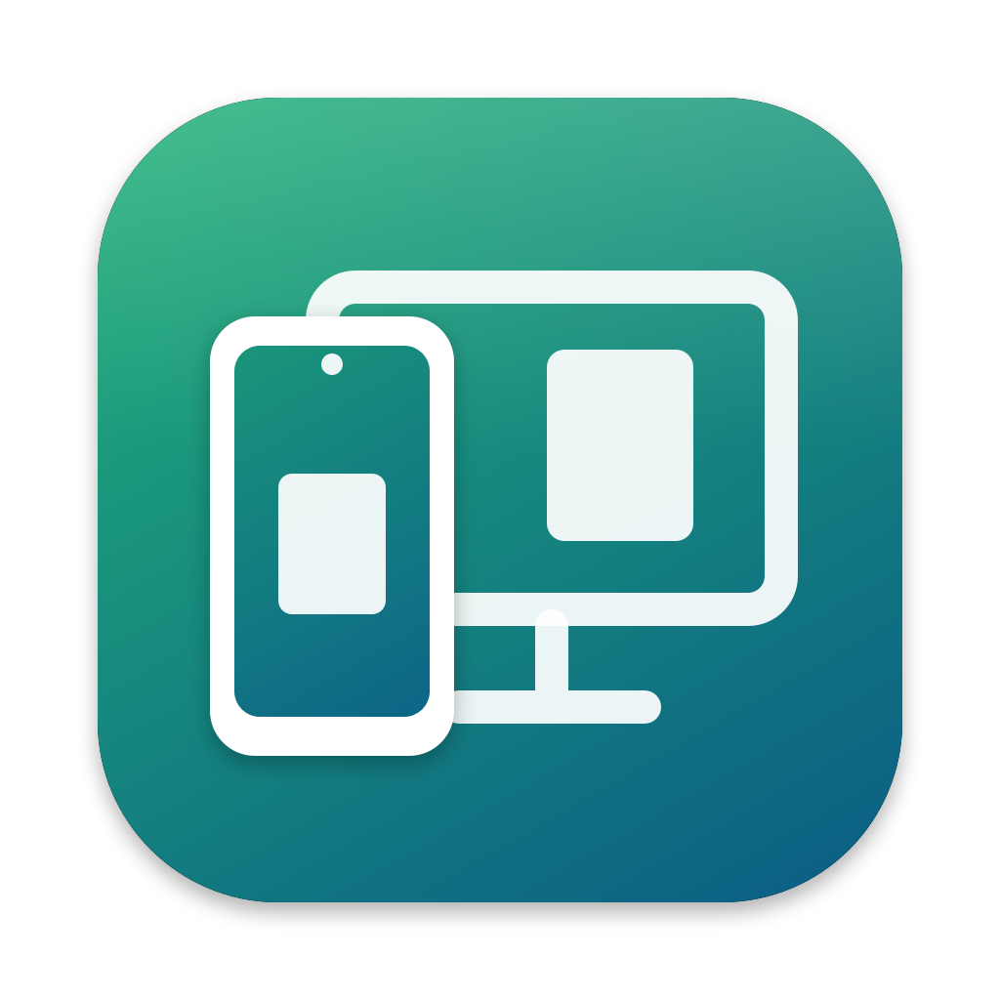
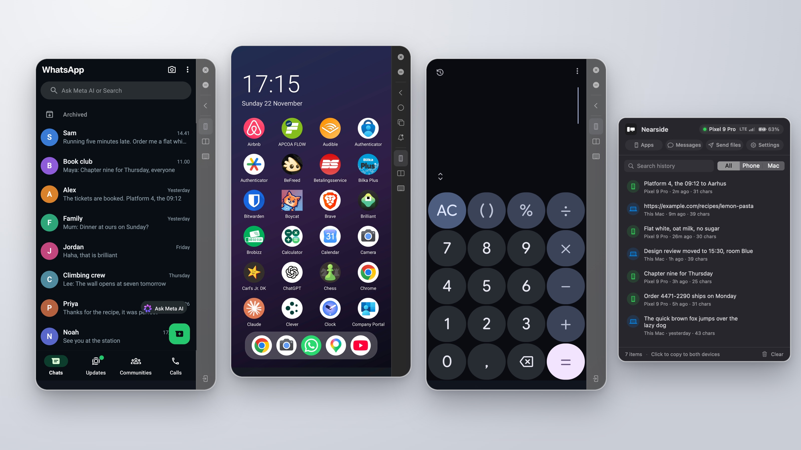
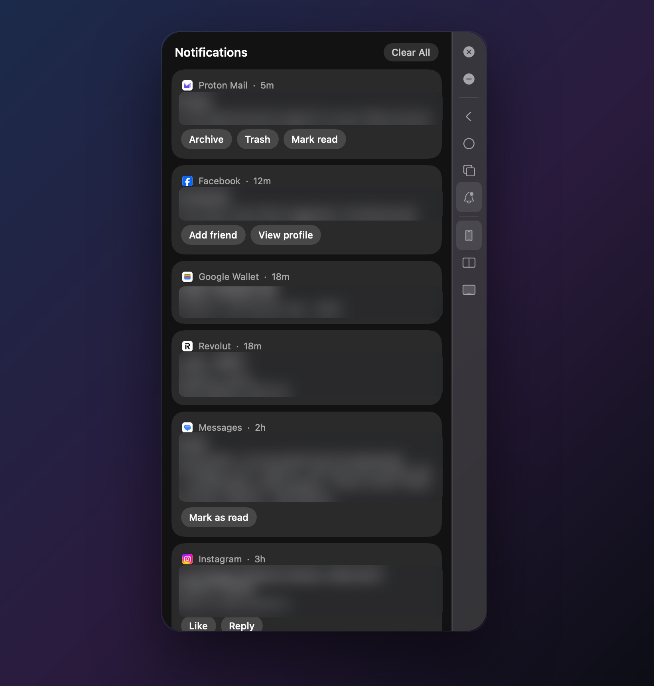
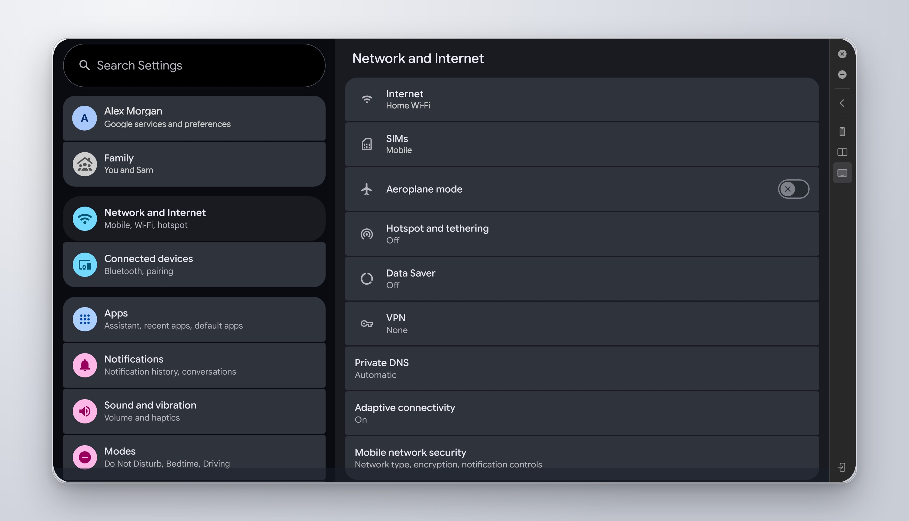

<div align="center">



# Nearside

**Continuity for Android and the Mac.**
Your phone's clipboard, notifications, messages, files and apps, on your Mac.
Open source. No cloud, no account.

[](LICENSE)
[](#requirements)
[](#requirements)
[](https://github.com/ramiejleh/Nearside/actions/workflows/ci.yml)
[](#status)
[](https://github.com/sponsors/ramiejleh)

[Website](https://ramiejleh.github.io/Nearside/) · [Features](#features) · [How it works](#how-it-works) ·
[Getting started](#getting-started) · [Privacy](#privacy-and-security) · [Support](#support-the-project)

<br>



<sub>Real windows on a Mac. Personal content is replaced with demo content.</sub>

</div>

---

Apple's Continuity is the reason many people stay on an iPhone. Nearside brings it to an
Android phone and a Mac:
- Copy on one and paste on the other.
- See and answer your notifications.
- Text from your Mac.
- Drop files either way.
- Open any phone app in its own Mac window, even while the phone stays locked in your pocket.

It runs quietly in the background. Everything travels directly between your two devices, over
an encrypted link on your own network or a USB cable.

## Features

### Phone apps on your Mac
Any app on your phone opens in its own Mac window, or you can open a whole second phone with its
own home screen.

- **Real windows.** They work with the Dock, ⌘-Tab, Mission Control and Spotlight, plus a
  launcher (⌥⌘P) with your recent and favourite apps. Optionally each phone app also becomes a
  small Mac app, so Raycast, Alfred and Launchpad find it.
- **The phone window.**
  - Nearside's own home screen with a dock.
  - Recents built from snapshots of your apps.
  - A notification panel (⌘3): open, reply, use a notification's buttons, or dismiss it.
- **Phone, foldable and tablet sizes.** Apps lay themselves out for each, exactly as they would
  on that device.
- **Input that feels native.** Trackpad scrolling with real flings, pinch, right-click and
  hover. Your Mac keyboard works in its own layout, and ⌘C / ⌘V copy and paste across devices.
- **Sound** plays on the Mac, per window, or on the phone if you prefer.
- **Works with the phone locked** and its screen off. Your Mac asks for Touch ID or your
  password first: after it wakes, every time, or never.
- **Leaves the phone alone.** Windows never take the phone's focus, so you can keep using the
  phone and its keyboard while apps are open on the Mac.
- **Smart about resources.** Windows you aren't looking at slow down or pause. Quality adapts to
  your connection and to how warm the phone is. Windows left hidden can go back to the phone
  after a while.
- **Smooth or responsive.** Smooth evens out Wi-Fi hiccups with a small, adaptive buffer;
  Responsive shows every frame the moment it arrives.
- **Seamless hand-off.** Open the app on the phone and it moves back there. Close the window
  and it's on your phone, where you left it.

<p align="center">
  
  
  
</p>

<p align="center"></p>

### Clipboard, both ways


Copy on the phone and paste on the Mac, or the other way round. It happens automatically,
without opening anything on the phone.
- A searchable history in the menu bar puts any earlier clip back on both clipboards.
- A small card tells you when something arrives.
- Items that password managers mark as concealed are never recorded.
- You can also hide Android's "pasted from your clipboard" message from the Mac.

### Notifications
Your phone's notifications appear as native macOS notifications, with their buttons and inline
replies. Dismiss one on either device and it's gone on both. **Open on Mac** opens a
notification's app in a Mac window, right where the notification points. You can choose whether
clicking a notification opens it on the phone or on the Mac.

### Text messages
Read and send SMS in a Messages window on the Mac: conversations, threads and new messages.
RCS chats stay in Google Messages.

<br clear="right">

### Files
- **To the phone:** drag files onto the menu-bar icon, or onto the drop shelf that slides out
  while you drag toward the top of the screen. A transfers list shows progress.
- **To the Mac:** use **Send to Mac** in Android's share sheet. Files land in your Downloads.
- **Into an app:** drop files onto a phone app's window to share them straight into that app.

### Keyboard shortcuts

| Shortcut | What it does |
|---|---|
| ⌥⌘P | Open the launcher (change it in Settings) |
| ⌥⇧⌘P | Open the phone window |
| ⌘[ | Back |
| ⌘1, ⌘2, ⌘3 | Home, Recents, Notifications (phone window) |
| ⌃⌘1, ⌃⌘2, ⌃⌘3 | Phone, foldable, tablet size |
| ⌘+, ⌘-, ⌘0 | Larger, smaller, actual size |
| ⌃⌘F | Full screen |
| ⌥⌘I | Show statistics (frame rate, bitrate, delay) |
| ⌘C, ⌘V | Copy and paste between the Mac and the app |

## How it works

<picture>
  <source media="(prefers-color-scheme: dark)" srcset="docs/images/architecture-dark.png">
  
</picture>

Android doesn't let ordinary apps read the clipboard in the background, or show other apps'
screens without asking every time. Nearside's Mac app starts a small helper on the phone over
**wireless debugging**, where it runs with the same rights as `adb shell`. It's the technique
[scrcpy](https://github.com/Genymobile/scrcpy) and [Shizuku](https://github.com/RikkaApps/Shizuku)
use. No root, no cloud service.

- The Mac has its **own adb client**, so there's nothing to install besides the app.
- **Phone-app windows are virtual displays** on the phone. The phone's hardware encodes them
  (HEVC), the Mac decodes them with VideoToolbox, and sound is captured per window and sent as
  Opus.
- **Plug in a USB cable** and the Mac switches to it, then goes back to Wi-Fi when you unplug.
- **After a reboot or a Wi-Fi change**, the phone turns wireless debugging back on and the Mac
  restarts the helper. You do nothing.

The [architecture notes](docs/architecture.md) go deeper.

## Getting started

### Requirements

| | |
|---|---|
| **Mac** | macOS 14 Sonoma or later (developed on Apple silicon; Intel untested) |
| **Phone** | Android 11 or later, on the same Wi-Fi network (or plugged in by USB once paired) |
| **Phone apps on the Mac** | Developed and tested on Android 17 (Pixel 9 Pro); earlier versions untested |

### Build it yourself

To build Nearside from source you need Xcode 26 or later and Android Studio (Gradle uses its
bundled JDK).

```sh
git clone https://github.com/ramiejleh/Nearside.git
cd Nearside
export JAVA_HOME="/Applications/Android Studio.app/Contents/jbr/Contents/Home"
(cd android && ./gradlew assembleDebug)   # the phone app, bundled into the Mac app
mac/scripts/bundle.sh                     # builds mac/build/Nearside.app
open mac/build/Nearside.app
```

The first launch opens a setup assistant. On the phone, turn on **Developer options →
Wireless debugging** and scan the pairing QR code your Mac shows. That's the only time you
touch the phone: the Mac installs the phone app and does the rest.

## Privacy and security

- **Nothing leaves your devices.** There is no server, account or telemetry.
- **Pinned to your phone.** During pairing, the Mac pins your phone's TLS key (the pairing code
  authenticates it), so a look-alike device on the network is refused. Over USB, the phone must
  first prove it holds this Mac's secret.
- **Mutual authentication.** The Mac and the helper prove to each other that they share a
  per-Mac secret, without ever sending it. The helper only trusts the shell user and the
  Nearside app, and phone-app streams need single-use tickets.
- **Touch ID or your password** before phone apps are shown, because they work while the phone
  is locked. The phone always shows that apps are open on your Mac, with a Stop button.
- **Your data stays yours.** Clipboard history lives in your Mac account only, readable by you
  alone. Concealed clipboard items are never stored.

The full design and threat model are in [`docs/security.md`](docs/security.md). Found a
vulnerability? Please report it privately; see [SECURITY.md](SECURITY.md).

## Status

Nearside is **alpha** software. It's built and used daily on a Pixel 9 Pro (Android 17) with a
MacBook. Known limitations:

- Apps that block screen capture (many banking apps) show black in a window. The window says so
  and offers to open the app on the phone.
- Calls stay on the phone.
- The phone's own on-screen keyboard can't show in a Mac window; you type with the Mac's.
- The Android app isn't on Google Play, because it needs SMS and notification access that
  Google restricts.

## Support the project

Nearside is free and always will be. If it saves you from carrying two ecosystems' worth of
cables and habits, you can support its development:

[](https://github.com/sponsors/ramiejleh)
[](https://ko-fi.com/ramiejleh)

Bug reports from phones other than the Pixel 9 Pro help just as much. See
[CONTRIBUTING.md](CONTRIBUTING.md).

## Project layout

```
mac/                     Swift package: the Mac app
  Sources/Nearside/        menu-bar app, windows, launcher, settings
  Sources/NearsideCore/    sync engine, protocols, video and audio pipeline
  Sources/NativeAdb/       adb client: TLS, pairing, USB, streams, file sync
android/                 Kotlin: the phone app and the shell-user helper
docs/                    architecture, security design, protocol, development
site/                    the project website (GitHub Pages)
```

Read [`docs/architecture.md`](docs/architecture.md) for how it works and why,
[`docs/security.md`](docs/security.md) for the security design and
[`docs/development.md`](docs/development.md) to work on it.

## Contributing

Issues and pull requests are welcome. See [CONTRIBUTING.md](CONTRIBUTING.md) and the
[code of conduct](CODE_OF_CONDUCT.md).

## Acknowledgements

Nearside stands on the shoulders of these projects:

- **[scrcpy](https://github.com/Genymobile/scrcpy)** by Genymobile and Romain Vimont
  (Apache-2.0). The helper's system workarounds, hidden-API wrappers, encoder setup, input
  injection and UHID keyboard are adapted from it.
- **[Android Open Source Project](https://source.android.com/)** (Apache-2.0). The Mac's adb
  client follows AOSP's adb protocol, pairing and key code.
- **[Shizuku](https://github.com/RikkaApps/Shizuku)** by RikkaApps. The shell-helper Binder
  handshake follows its approach.
- **[SwiftNIO SSL](https://github.com/apple/swift-nio-ssl)** and **[BoringSSL](https://boringssl.googlesource.com/boringssl/)**
  provide the TLS and SPAKE2 cryptography under the adb client, with
  [SwiftNIO](https://github.com/apple/swift-nio), Swift Atomics, Swift Collections and
  Swift System.
- **[KDE Connect](https://kdeconnect.kde.org/)**, for showing for years that phones and
  computers should simply work together.

Full attributions are in [NOTICE](NOTICE). Android is a trademark of Google LLC; Mac, macOS and
Continuity are trademarks of Apple Inc. Nearside is not affiliated with either.

## License

[GNU Affero General Public License v3.0](LICENSE) or later. Copyright 2026 The Nearside contributors.

You may use, change and share Nearside freely. If you distribute it, or a changed version,
or let people use a changed version over a network, you must release your source code under
the same licence. The code adapted from scrcpy and AOSP stays under its Apache 2.0 notices.
