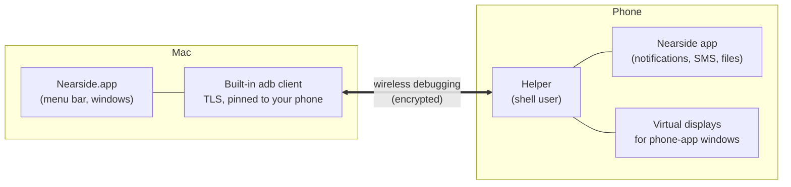

<div align="center">


# Nearside

**Continuity for Android and the Mac.**
Your phone's clipboard, notifications, messages, files — and its apps — on your Mac.
Open source. No cloud, no account, nothing to tap on the phone.

[](LICENSE)
[](#requirements)
[](#requirements)
[](mac/Package.swift)
[](android)
[](#privacy-and-security)
[](#status)
[](CONTRIBUTING.md)

[Features](#features) · [How it works](#how-it-works) · [Getting started](#getting-started) ·
[Privacy](#privacy-and-security) · [Contributing](CONTRIBUTING.md) · [Credits](#acknowledgements)

</div>

---

Apple's Continuity is the reason many people stay on an iPhone. Nearside brings it to an
Android phone and a Mac: copy on one, paste on the other; see and answer your notifications;
text from your Mac; drop files either way; and open any phone app in its own Mac window, even
while the phone stays locked in your pocket.

It runs quietly in the background. Everything travels directly between your two devices over
an encrypted link on your own network.

## Features

### 📋 Clipboard, both ways
Copy on the phone, paste on the Mac — and back. Automatically, without opening anything on the
phone. A searchable history in the menu bar puts any earlier clip back on both clipboards, and
a small card tells you when something arrives. Items password managers mark as concealed are
never recorded.

### 🔔 Notifications
Your phone's notifications appear as native macOS notifications, with their buttons and inline
replies. Dismiss one on either device and it's gone on both. **Open on Mac** opens a
notification's app in a Mac window, right where the notification points.

### 💬 Text messages
Read and send SMS in a Messages window on the Mac.

### 📁 Files
Drag files onto the menu-bar icon to send them to the phone; use **Send to Mac** in Android's
share sheet to put files in your Mac's Downloads. Drop files onto a phone app's window to share
them straight into that app.

### 📱 Phone apps on your Mac
Any app on your phone, in its own native Mac window — or a whole second phone with its own home
screen:

- **Real windows**: Dock, ⌘-Tab, Mission Control, Spotlight, a launcher (⌥⌘P) with your recent
  and favourite apps.
- **Phone, foldable and tablet sizes**: apps lay themselves out for each, exactly as they would
  on that device.
- **Input that feels native**: trackpad scrolling with real flings, pinch, right-click, hover,
  your Mac keyboard and its layout, ⌘C / ⌘V across devices.
- **Sound on the Mac**, per window, with the phone silent.
- **Works with the phone locked** and its screen off; your Mac asks for Touch ID first.
- **Smart about resources**: windows you aren't looking at slow down or pause; quality adapts to
  your Wi-Fi and to how warm the phone is.
- **Seamless hand-off**: open the app on the phone and it moves back there; close the window and
  it's on your phone, where you left it.
- More than one Mac? The newest takes over politely; the other one waits.

## How it works

Android lets ordinary apps neither read the clipboard in the background nor show other apps'
screens without asking every time. Nearside's Mac app starts a small helper on the phone over
**wireless debugging**, where it runs with the same rights as `adb shell` — the technique
[scrcpy](https://github.com/Genymobile/scrcpy) and [Shizuku](https://github.com/RikkaApps/Shizuku)
use. No root, no cloud service.



- The Mac has its **own adb client** — nothing to install besides the app.
- Phone-app windows are **virtual displays** on the phone, encoded with its hardware HEVC
  encoder and decoded with VideoToolbox; sound is captured per window and sent as Opus.
- After a reboot or a Wi-Fi change, the phone turns wireless debugging back on and the Mac
  restarts the helper. You do nothing.

## Getting started

### Requirements

| | |
|---|---|
| **Mac** | macOS 14 Sonoma or later (developed on Apple silicon; Intel untested) |
| **Phone** | Android 11 or later, on the same Wi-Fi network |
| **Phone apps on the Mac** | Developed and tested on Android 17 (Pixel 9 Pro); earlier versions untested |

### Build and run

There are no signed releases yet; build from source (Xcode 16+ and Android Studio's JDK):

```sh
git clone https://github.com/ramiejleh/Nearside.git
cd Nearside
(cd android && ./gradlew assembleDebug)   # the phone app (bundled into the Mac app)
mac/scripts/bundle.sh                          # → mac/build/Nearside.app
open mac/build/Nearside.app
```

The first launch opens a setup assistant. On the phone, turn on **Developer options →
Wireless debugging** and scan the pairing QR code your Mac shows. The Mac installs the phone app
and does the rest.

## Privacy and security

- **Nothing leaves your network.** There is no server, account or telemetry.
- **Pinned to your phone.** The Mac pins your phone's TLS key during pairing (authenticated by
  the pairing code); a look-alike device on the network is refused.
- **Mutual authentication.** The Mac and the helper prove to each other that they share a
  per-Mac secret, without ever sending it. The helper only trusts the shell user and the
  Nearside app; phone-app streams need single-use tickets.
- **Touch ID** before phone apps are shown (after the Mac wakes, by default), because they work
  while the phone is locked. The phone always shows that apps are open on your Mac, with a Stop
  button.
- **Your data stays yours.** Clipboard history lives in your Mac account only (readable by you
  alone); concealed clipboard items are never stored.

Found a vulnerability? Please report it privately; see [SECURITY.md](SECURITY.md).

## Status

Nearside is **alpha** software, built and used daily on a Pixel 9 Pro (Android 17) with a
MacBook. Known limitations:

- No signed, notarised release yet (build from source).
- Apps that block screen capture (many banking apps) show black in a window; the window says so
  and offers to open them on the phone.
- Calls stay on the phone.
- The Android app isn't on Google Play (it needs SMS and notification access Google restricts).

## Project layout

```
mac/                      Swift package: the Mac app
  Sources/Nearside/      menu-bar app, windows, launcher, settings
  Sources/NearsideCore/  sync engine, protocols, video and audio pipeline
  Sources/NativeAdb/        adb client: TLS, pairing, streams, file sync
android/              Kotlin: the phone app and the shell-user helper
docs/                     architecture, security design, protocol, development
```

Read [`docs/architecture.md`](docs/architecture.md) for how it works and why,
[`docs/security.md`](docs/security.md) for the security design and
[`docs/development.md`](docs/development.md) to work on it.

## Contributing

Issues and pull requests are welcome — see [CONTRIBUTING.md](CONTRIBUTING.md).

## Acknowledgements

Nearside stands on the shoulders of these projects:

- **[scrcpy](https://github.com/Genymobile/scrcpy)** by Genymobile and Romain Vimont
  (Apache-2.0) — the helper's system workarounds, hidden-API wrappers, encoder setup, input
  injection and UHID keyboard are adapted from it.
- **[Android Open Source Project](https://source.android.com/)** (Apache-2.0) — the Mac's adb
  client follows AOSP's adb protocol, pairing and key code.
- **[Shizuku](https://github.com/RikkaApps/Shizuku)** by RikkaApps — the shell-helper
  Binder handshake follows its approach.
- **[SwiftNIO SSL](https://github.com/apple/swift-nio-ssl)** and **[BoringSSL](https://boringssl.googlesource.com/boringssl/)**
  — the TLS and SPAKE2 cryptography under the adb client, with
  [SwiftNIO](https://github.com/apple/swift-nio), Swift Atomics, Swift Collections and
  Swift System.
- **[KDE Connect](https://kdeconnect.kde.org/)** — for showing for years that phones and
  computers should simply work together.

Full attributions are in [NOTICE](NOTICE). Android is a trademark of Google LLC; Mac, macOS and
Continuity are trademarks of Apple Inc. Nearside is not affiliated with either.

## License

[Apache License 2.0](LICENSE). Copyright 2026 The Nearside contributors.
