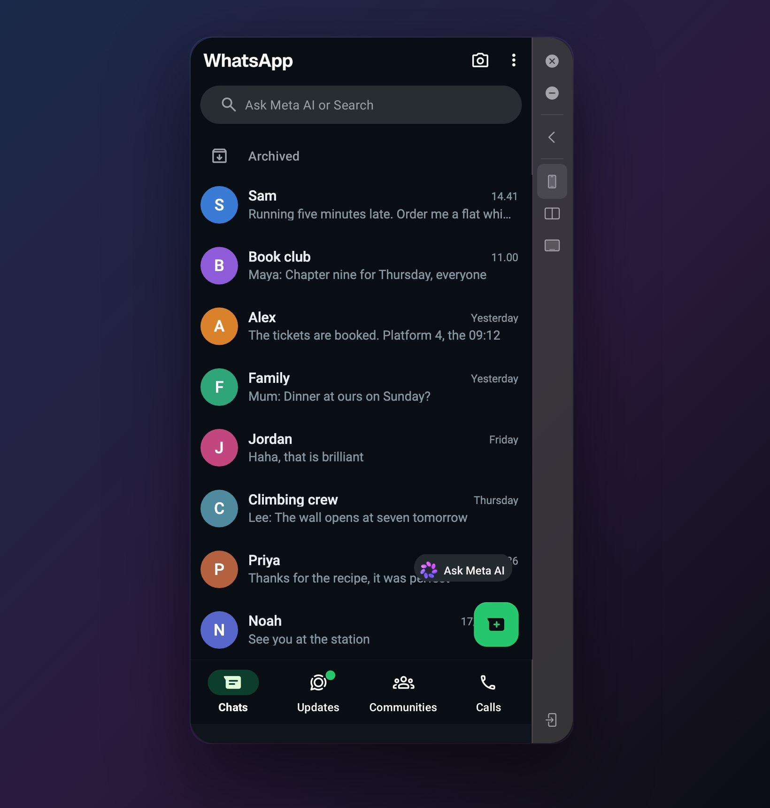
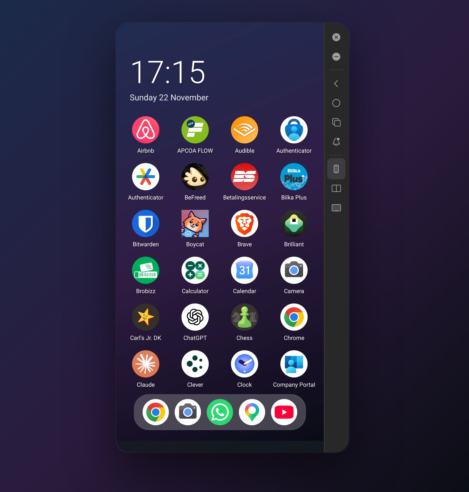
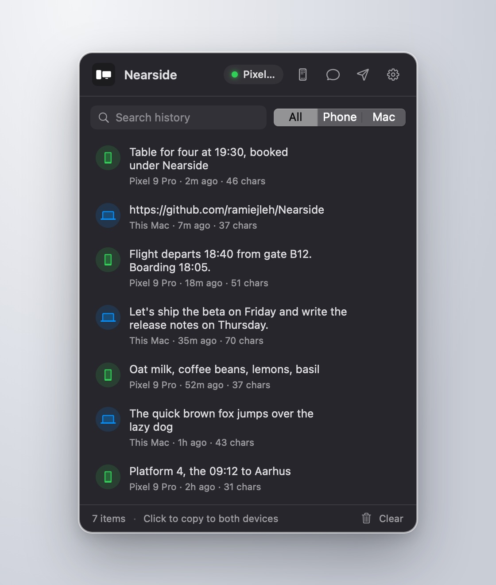

<div align="center">


# Nearside

**Continuity for Android, on your Mac or Windows PC.**
Your phone's clipboard, notifications, messages, files and apps, on your computer.
Open source. No cloud, no account.

[](LICENSE)
[](#requirements)
[](#requirements)
[](#requirements)
[](https://github.com/ramiejleh/Nearside/actions/workflows/ci.yml)
[](#status)
[](https://github.com/sponsors/ramiejleh)

[Website](https://ramiejleh.github.io/Nearside/) · [Features](#features) · [How it works](#how-it-works) ·
[Getting started](#getting-started) · [Privacy](#privacy-and-security) · [Support](#support-the-project)

<br>


<sub>Real windows on a Mac. Personal content is replaced with demo content.</sub>

</div>

---

Apple's Continuity is the reason many people stay on an iPhone. Nearside brings it to an
Android phone and a Mac or a Windows PC:
- Copy on one and paste on the other.
- See and answer your notifications.
- Text from your computer.
- Drop files either way.
- Open any phone app in its own window, even while the phone stays locked in your pocket.

It runs quietly in the background, in the Mac's menu bar or the PC's notification area.
Everything travels directly between your two devices, over an encrypted link on your own network
or a USB cable.

The features below are described for the Mac; the Windows app has the same ones, with the
differences noted under each. It's new and still being tested on real PCs (see
[what's tested](#whats-tested-and-where)).

## Features

### Phone apps on your computer
Any app on your phone opens in its own window on your computer, or you can open a whole second phone with its
own home screen.

- **Real windows.** They work with the Dock, ⌘-Tab, Mission Control and Spotlight, plus a
  launcher (⌥⌘P) with your recent and favourite apps. Optionally each phone app also becomes a
  small Mac app, so Raycast, Alfred and Launchpad find it.
- **The phone window.**
  - Nearside's own home screen with a dock.
  - Recents built from snapshots of your apps.
  - A notification panel (⌘3): open, reply, use a notification's buttons, or dismiss it.
- **Phone, foldable and tablet sizes.** Apps lay themselves out for each, exactly as they would
  on that device.
- **Input that feels native.** Trackpad scrolling with real flings, pinch, right-click and
  hover. Your Mac keyboard works in its own layout, and ⌘C / ⌘V copy and paste across devices.
- **Sound** plays on the Mac, per window, or on the phone if you prefer. Apps that record (a
  WhatsApp call, a voice message) hear the Mac's microphone, only while they record.
- **Works with the phone locked** and its screen off. Your Mac asks for Touch ID or your
  password first: after it wakes, every time, or never.
- **Leaves the phone alone.** Windows never take the phone's focus, so you can keep using the
  phone and its keyboard while apps are open on the Mac.
- **Smart about resources.** Windows you aren't looking at slow down or pause. Quality adapts to
  your connection and to how warm the phone is. Windows left hidden can go back to the phone
  after a while.
- **Smooth or responsive.** Smooth evens out Wi-Fi hiccups with a small, adaptive buffer;
  Responsive shows every frame the moment it arrives.
- **Seamless hand-off.** Open the app on the phone and it moves back there. Close the window
  and it's on your phone, where you left it.
- **Up to 120 frames a second** on a fast screen, if your phone runs Android 14 or later and the
  Wi-Fi keeps up (Settings → Frame rate).

**On Windows:** each window has its own taskbar button and shows in Alt+Tab. Phone apps can go in
the Start menu, each with a small Nearside badge. The launcher is Ctrl+Alt+N, and Windows Hello
(or your PIN) stands in for Touch ID. The PC decodes on its graphics card (H.264), with Direct3D.

<p align="center">
  
  
  
</p>

<p align="center"></p>

### Clipboard, both ways



Copy on the phone and paste on the Mac, or the other way round. It happens automatically,
without opening anything on the phone.
- The panel has two tabs: **Notifications**, what's on your phone right now, and **Clipboard**, a
  searchable history that puts any earlier clip back on both clipboards.
- A small card tells you when something arrives.
- Items that password managers mark as concealed are never recorded.
- You can also hide Android's "pasted from your clipboard" message from the Mac.
- While the phone is away, the panel shows nothing of it: only where it is, Settings, and
  **Connect** when another computer has it. Nothing is recorded meanwhile.

### Photos and screenshots
The panel shows your phone's newest photos and screenshots while it's open. Drag one into any
app or folder to get the full file, or click to open it. You can also have each new phone
screenshot land in Downloads, and each Mac screenshot go to the phone's gallery.

### Calls
Incoming calls ring on the Mac with Answer, Decline, or decline with a text, for phone calls and
app calls (WhatsApp, Messenger, Signal) alike. Answered or placed on the Mac, a call talks
through the Mac: its sound and the Mac's microphone, the phone's own microphone off. During a
call a small card under the menu-bar icon shows the time, Mute and End, and moves the call to the
phone and back in one click. Call a number from Messages or from clipboard history. On Windows,
calls ring as a Windows notification and the in-call card sits above the notification area.

### Phone camera as a webcam
Pick "Nearside Camera" in FaceTime, Zoom, a browser or Photo Booth: the phone's back or front
camera, upright however you hold it. The phone's camera is on only while an app uses it, and the
phone says so, with a Stop button. Turn it on in Settings › Phone camera (macOS asks you to allow
the camera extension once). On Windows it's in Teams, Zoom, the Camera app and browsers, installed
with the app.

### Phone status
The menu bar shows your phone's battery, signal and network (5G, LTE) while it's connected,
and tells you once when its battery runs low.

### Notifications
Your phone's notifications appear as native macOS or Windows notifications, with their buttons
and inline replies. Dismiss one on either device and it's gone on both. **Open on Mac** (**Open
on PC**) opens a notification's app in a window, right where the notification points. The
panel's Notifications tab lists what's on the phone now.
- **Mute** them from the bell in the panel, for 1 to 24 hours or until you turn them back on.
  When it ends, what's still on the phone appears.
- **While the phone is away** they're cleared from the computer, and come back when it
  reconnects. After a minute away, its apps also leave Spotlight, Applications or the Start
  menu until it's back.

### Text messages
Read and send SMS in a Messages window on the Mac: conversations, threads and new messages.
RCS chats stay in Google Messages.

<br clear="right">

### Files
- **To the phone:** drag files onto the menu-bar icon, or onto the drop shelf that slides out
  while you drag toward the top of the screen. On Windows, drop them on the panel. A transfers
  list shows progress.
- **To the computer:** use **Send to computer** in Android's share sheet. Files land in your
  Downloads.
- **Into an app:** drop files onto a phone app's window to share them straight into that app.

### Keyboard shortcuts

| Mac | Windows | What it does |
|---|---|---|
| ⌥⌘P | Ctrl+Alt+N | Open the launcher (change it in Settings on the Mac) |
| ⌥⇧⌘P | | Open the phone window |
| ⌘[ | Esc | Back |
| ⌘1, ⌘2, ⌘3 | | Home, Recents, Notifications (phone window) |
| ⌃⌘1, ⌃⌘2, ⌃⌘3 | | Phone, foldable, tablet size |
| ⌘+, ⌘-, ⌘0 | Drag the window's edge | Larger, smaller (⌘0: actual size) |
| ⌃⌘F | | Full screen |
| ⌥⌘I | | Show statistics (frame rate, bitrate, delay) |
| ⌘C, ⌘V | Ctrl+C, Ctrl+V | Copy and paste between the computer and the app |

On Windows the phone window's toolbar has Home, Recents, Notifications and the sizes.

## How it works

<picture>
  <source media="(prefers-color-scheme: dark)" srcset="docs/images/architecture-dark.png">
  
</picture>

Android doesn't let ordinary apps read the clipboard in the background, or show other apps'
screens without asking every time. Nearside's computer app starts a small helper on the phone over
**wireless debugging**, where it runs with the same rights as `adb shell`. It's the technique
[scrcpy](https://github.com/Genymobile/scrcpy) and [Shizuku](https://github.com/RikkaApps/Shizuku)
use. No root, no cloud service.

- The computer has its **own adb client**, so there's nothing to install besides the app. The
  Mac and Windows apps share one engine, written in Swift.
- **Phone-app windows are virtual displays** on the phone. The phone's hardware encodes them
  (HEVC for the Mac, H.264 for a PC), the computer decodes them on its graphics hardware, and
  sound is captured per window and sent as Opus.
- **Plug in a USB cable** and the computer switches to it, then goes back to Wi-Fi when you
  unplug. Windows needs no driver.
- **After a reboot or a Wi-Fi change**, the phone turns wireless debugging back on and the
  computer restarts the helper. You do nothing.
- **One computer at a time.** If your Mac has the phone, the PC shows where it is, with
  **Connect** to take it over, and the other way round.

The [architecture notes](docs/architecture.md) go deeper.

## Getting started

### Requirements

| | |
|---|---|
| **Mac** | macOS 14 Sonoma or later |
| **PC** | Windows 11 (x64 or Arm) |
| **Phone** | Android 11 or later, on the same Wi-Fi network (or plugged in by USB once paired) |

### What's tested, and where

Everything below is tested on **one setup**: a **Google Pixel 9 Pro on Android 17 beta (API 37)**
with a **MacBook Air (Apple M5) on macOS 27.0.1**, over Wi-Fi and over USB. Nothing else has been
tested yet: other phones, Android 11 to 16, macOS 14 to 26 and Intel Macs may work, or may not.
[Reports](https://github.com/ramiejleh/Nearside/issues/new/choose) from other setups are very
welcome.

The Windows app is new and **not tested on a real PC yet**: so far in a Windows 11 Arm virtual
machine, which has no graphics card for video decoding, no Windows Hello and no USB. Real-PC
results will fill in this column.

| Feature | Mac (macOS 27) | Windows 11 | Notes |
|---|---|---|---|
| Clipboard, both ways, with history | Tested | Not yet | |
| Notifications, with buttons and replies | Tested | Not yet | |
| Text messages (SMS) | Tested | Not yet | RCS stays in Google Messages |
| Files, both ways | Tested | Not yet | |
| Phone apps in computer windows, with sound | Tested | Not yet | Uses Android's virtual devices |
| The computer's microphone in app windows | Tested | Not yet | WhatsApp and Messenger calls |
| Phone status (battery, signal, network) | Tested | Not yet | |
| Photos and screenshots | Tested | Not yet | |
| Incoming calls: answer, decline, reply | Tested | Not yet | Phone, WhatsApp and Messenger calls |
| Phone calls through the computer (sound and microphone) | Tested | Not yet | Uses the in-call audio paths Pixel's Call Screen uses |
| Phone camera as a webcam, back and front | Tested | Not yet | Mac: release builds only (needs Apple signing) |
| USB cable | Tested | Not yet | |
| Wi-Fi (wireless debugging) | Tested | Not yet | |
| Phone-app windows at 90 or 120 frames a second | Not yet | Not yet | Android 14 or later |
| Muting notifications, the Notifications tab | Not yet | Not yet | New |

### Install

On the Mac, download `Nearside-<version>.zip` from the [latest release](https://github.com/ramiejleh/Nearside/releases/latest),
unzip it and move Nearside to Applications. Or, with [Homebrew](https://brew.sh):

```sh
brew install --cask ramiejleh/tap/nearside
```

Releases are signed and notarised by Apple. Nearside checks for updates by itself, and
**Settings → General → Check for Updates…** checks now.

On Windows, download `Nearside-<version>-x64.exe` (or `-arm64.exe` for Arm PCs) from the same
release and run it, or use winget:

```
winget install Nearside.Nearside
```

It installs for everyone on the PC (it asks for an administrator once, for the webcam). Nearside
checks for updates by itself; **Check for updates** in its notification-area menu checks now.
When either app updates, it updates the phone app too.

### Build it yourself

To build the Mac app from source you need Xcode 26 or later and Android Studio (Gradle uses its
bundled JDK).

```sh
git clone https://github.com/ramiejleh/Nearside.git
cd Nearside
export JAVA_HOME="/Applications/Android Studio.app/Contents/jbr/Contents/Home"
(cd android && ./gradlew assembleDebug)   # the phone app, bundled into the Mac app
mac/scripts/bundle.sh                     # builds mac/build/Nearside.app
open mac/build/Nearside.app
```

On Windows you need the Swift toolchain, the Visual Studio Build Tools and the .NET 10 SDK; see
[Developing on Windows](docs/development-windows.md).

The first launch opens a setup assistant. On the phone, turn on **Developer options →
Wireless debugging** and scan the pairing QR code your computer shows. That's the only time you
touch the phone: the computer installs the phone app and does the rest.

## Privacy and security

- **Nothing leaves your devices.** There is no server, account or telemetry.
- **Pinned to your phone.** During pairing, the computer pins your phone's TLS key (the pairing
  code authenticates it), so a look-alike device on the network is refused. Over USB, the phone
  must first prove it holds this computer's secret.
- **Mutual authentication.** The computer and the helper prove to each other that they share a
  per-computer secret, without ever sending it. The helper only trusts the shell user and the
  Nearside app, and phone-app streams need single-use tickets.
- **Touch ID, Windows Hello or your password** before phone apps are shown, because they work
  while the phone is locked. The phone always shows that apps are open on your computer, with a
  Stop button.
- **Your data stays yours.** Clipboard history lives in your user account only, readable by you
  alone. Concealed clipboard items are never stored.

The full design and threat model are in [`docs/security.md`](docs/security.md). Found a
vulnerability? Please report it privately; see [SECURITY.md](SECURITY.md).

## Status

Nearside is **alpha** software. It's built and used daily on a Pixel 9 Pro (Android 17 beta)
with a MacBook Air (macOS 27); the Windows app is newer still. See
[what's tested](#whats-tested-and-where). Known limitations:

- Apps that block screen capture (many banking apps) show black in a window. The window says so
  and offers to open the app on the phone.
- Calls on the Mac use Android's in-call audio paths (the ones Pixel's Call Screen uses); other
  phones may not offer them, and then a call talks on the phone.
- The webcam needs Nearside from the releases (or your own Apple developer signing, see
  [development.md](docs/development.md)): macOS loads camera extensions only when signed,
  provisioned and notarised.
- The phone's own on-screen keyboard can't show in a window; you type with the computer's.
- The phone works with one computer at a time; **Connect** moves it from one to the other.
- Windows: the PC asks the phone for H.264, as Windows' own HEVC decoder is a paid extension.
- The Android app isn't on Google Play, because it needs SMS and notification access that
  Google restricts.

## Support the project

Nearside is free and always will be. If it saves you from carrying two ecosystems' worth of
cables and habits, you can support its development:

[](https://github.com/sponsors/ramiejleh)
[](https://ko-fi.com/ramiejleh)

Bug reports from phones other than the Pixel 9 Pro help just as much. See
[CONTRIBUTING.md](CONTRIBUTING.md).

## Project layout

```
core/                    Swift package: the engine, shared by the Mac and Windows apps
  Sources/NearsideCore/    sync engine, protocols, display, call and camera streams
  Sources/NativeAdb/       adb client: TLS, pairing, USB, streams, file sync
mac/                     Swift package: the Mac app
  Sources/Nearside/        menu-bar app, windows, launcher, settings
  Sources/NearsideMac/     the engine's Mac parts: video decoding, audio, microphone,
                           pasteboard, notifications, screenshots
  Sources/NearsideCamera/  the camera extension (the phone as a webcam)
windows/                 the Windows app: the engine as a DLL, the WinUI 3 app (C#), the
                         webcam's media source (C++) and the installer (see windows/README.md)
android/                 Kotlin: the phone app and the shell-user helper
docs/                    architecture, security design, protocol, development (Mac, Windows,
                         adding a platform), releasing
site/                    the project website (GitHub Pages)
```

Read [`docs/architecture.md`](docs/architecture.md) for how it works and why,
[`docs/security.md`](docs/security.md) for the security design and
[`docs/development.md`](docs/development.md) to work on it (with pages for
[the Mac](docs/development-mac.md), [Windows](docs/development-windows.md) and
[adding a platform](docs/adding-a-platform.md), such as Linux).

## Contributing

Issues and pull requests are welcome. See [CONTRIBUTING.md](CONTRIBUTING.md) and the
[code of conduct](CODE_OF_CONDUCT.md).

## Acknowledgements

Nearside stands on the shoulders of these projects:

- **[scrcpy](https://github.com/Genymobile/scrcpy)** by Genymobile and Romain Vimont
  (Apache-2.0). The helper's system workarounds, hidden-API wrappers, encoder setup, input
  injection and UHID keyboard are adapted from it.
- **[Android Open Source Project](https://source.android.com/)** (Apache-2.0). The Mac's adb
  client follows AOSP's adb protocol, pairing and key code.
- **[Shizuku](https://github.com/RikkaApps/Shizuku)** by RikkaApps. The shell-helper Binder
  handshake follows its approach.
- **[SwiftNIO SSL](https://github.com/apple/swift-nio-ssl)** and **[BoringSSL](https://boringssl.googlesource.com/boringssl/)**
  provide the TLS and SPAKE2 cryptography under the adb client, with
  [SwiftNIO](https://github.com/apple/swift-nio), Swift Atomics, Swift Collections and
  Swift System.
- On Windows: **[FFmpeg](https://ffmpeg.org/)** (LGPL) decodes video and sound,
  **[WinSparkle](https://winsparkle.org/)** brings updates, and the
  **[Windows App SDK](https://github.com/microsoft/WindowsAppSDK)** draws the interface.
- **[KDE Connect](https://kdeconnect.kde.org/)**, for showing for years that phones and
  computers should simply work together.

Full attributions are in [NOTICE](NOTICE). Android is a trademark of Google LLC; Mac, macOS and
Continuity are trademarks of Apple Inc.; Windows is a trademark of Microsoft Corporation.
Nearside is not affiliated with any of them.

## License

[GNU Affero General Public License v3.0](LICENSE) or later. Copyright 2026 The Nearside contributors.

You may use, change and share Nearside freely. If you distribute it, or a changed version,
or let people use a changed version over a network, you must release your source code under
the same licence. The code adapted from scrcpy and AOSP stays under its Apache 2.0 notices.
