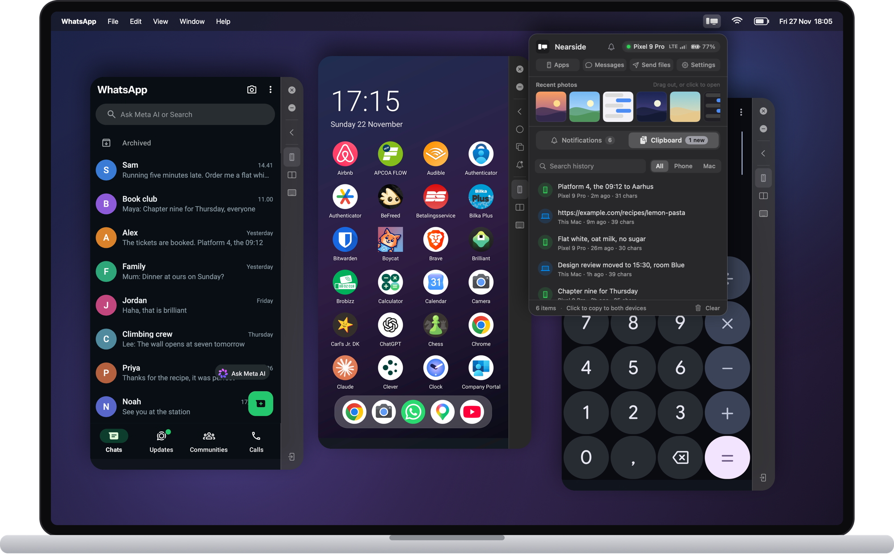
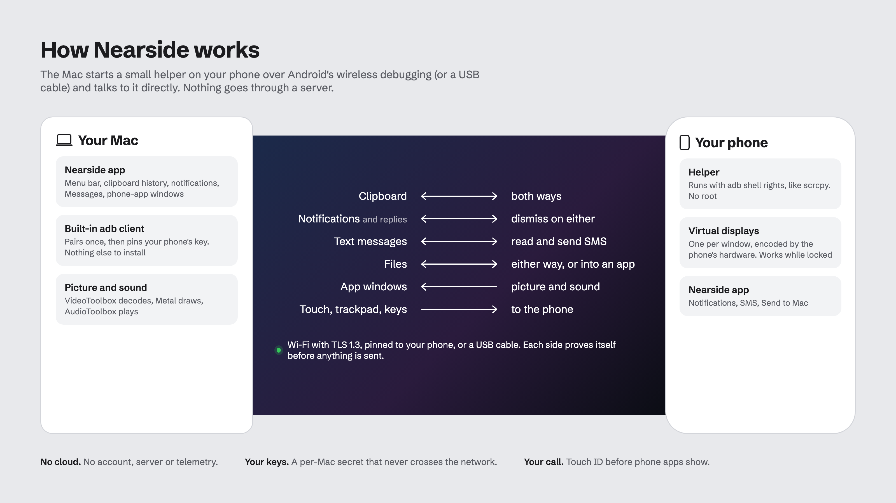
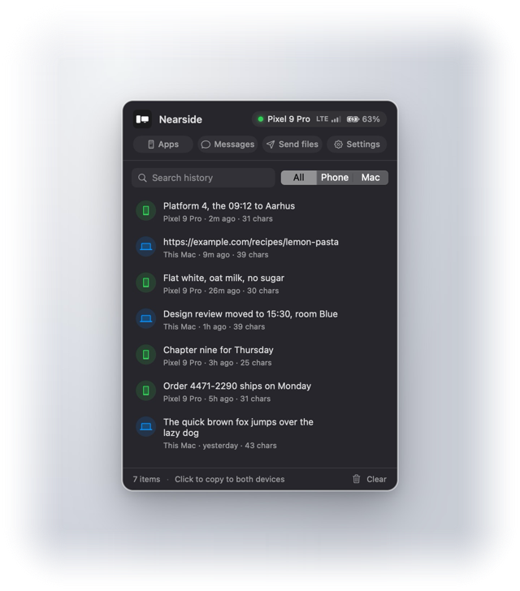
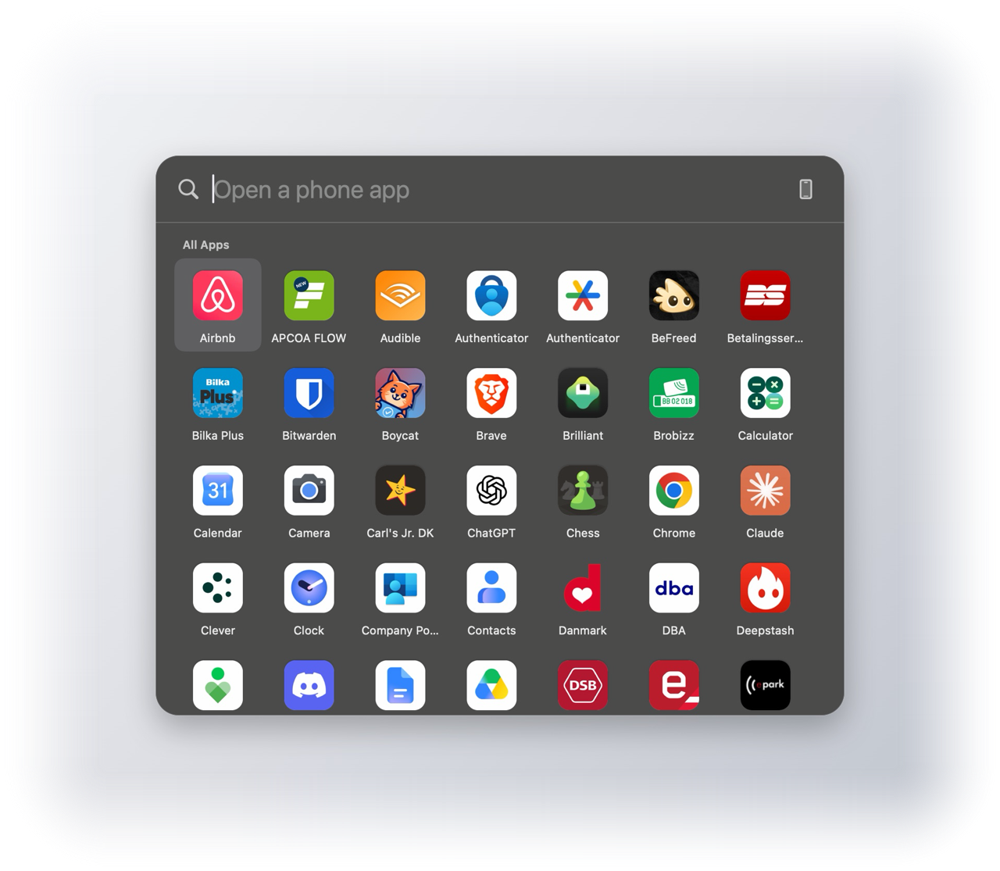

<div align="center">


# Nearside

**Continuity the way it was meant to be.**
The most seamless way to use an Android phone with a Mac or a Windows PC.

[](LICENSE)
[](docs/getting-started.md#requirements)
[](docs/getting-started.md#requirements)
[](docs/getting-started.md#requirements)
[](https://github.com/ramiejleh/Nearside/actions/workflows/ci.yml)
[](docs/getting-started.md#status)
[](https://github.com/sponsors/ramiejleh)

[](https://github.com/ramiejleh/Nearside/releases/latest/download/Nearside-mac.zip)
[](https://github.com/ramiejleh/Nearside/releases/latest/download/Nearside-windows-x64.exe)
[](https://github.com/ramiejleh/Nearside/releases/latest/download/Nearside-windows-arm64.exe)

[Website](https://ramiejleh.github.io/Nearside/) · [Features](#features) · [Get started](#get-started) ·
[Support](#support-the-project)

<br>



<sub>Real windows on a Mac. Personal content is replaced with demo content.</sub>

</div>

---

Apple's Continuity is the reason many people stay on an iPhone: copy on one device and paste on
the other, answer calls and texts from the laptop, move files without thinking about it. It only
works if every device you own is Apple's.

**Nearside brings all of that to an Android phone, and takes it further.** Pair it once and your
phone and your computer behave like one setup:

- **Every phone app in its own window**, side by side with your computer's apps, while the phone
  stays locked in your pocket. Not one mirrored phone screen: as many apps as you like, each
  with its own window, sound and size.
- **One clipboard** across both, with a searchable history.
- **Notifications, texts and calls** on your computer, with replies, buttons and your computer's
  microphone and speakers.
- **Files and photos** in either direction, by drag and drop.
- **Your phone as a webcam** in any video app.
- **A Mac or a Windows PC**, or both: move the phone between them with one click.

So if you love your Mac but prefer Android, you don't have to choose. Pick the phone you want,
keep the laptop you want, and still get the continuity that makes them feel like one.

Nearside is free and open source. There's no cloud and no account: everything travels directly
between your two devices, over an encrypted link on your own network or a USB cable.

## How it works

<picture>
  <source media="(prefers-color-scheme: dark)" srcset="docs/images/architecture-dark.png">
  
</picture>

Nearside's computer app starts a small helper on your phone over Android's **wireless
debugging**, the technique [scrcpy](https://github.com/Genymobile/scrcpy) and
[Shizuku](https://github.com/RikkaApps/Shizuku) use. No root, no server in the middle. The
[architecture notes](docs/architecture.md) and the [security design](docs/security.md) go deeper.

## Support the project

Nearside is free and always will be: no ads, no accounts, no paid tier. If it makes your phone
and your computer feel like they belong together, you can help keep it going:

[](https://github.com/sponsors/ramiejleh)
[](https://ko-fi.com/ramiejleh)

## Features



- **Phone apps in real windows.** In the Dock, ⌘-Tab, Spotlight and a launcher on the Mac; on the
  taskbar, Alt+Tab and the Start menu on a PC. Phone, foldable or tablet size, with native
  trackpad, mouse and keyboard input, and sound per window. Close the window and the app is back
  on your phone, where you left it.
- **Works while the phone is locked**, behind Touch ID or Windows Hello on the computer.
- **Clipboard, both ways**, automatically, with a searchable history. Concealed items from
  password managers are never kept.
- **Notifications** as native macOS or Windows notifications, with their buttons and replies.
  Dismiss on one, gone on both. Mute any app, or all of them for a while.
- **Calls** ring on the computer: answer, decline or reply with a text, then talk through your
  computer's microphone and speakers. Phone calls and WhatsApp, Messenger or Signal alike.
- **Text messages** in a Messages window on your computer.
- **Photos and screenshots**: the phone's newest in the panel, to drag out or open, and new
  screenshots sent across by themselves.
- **Files** both ways: drop them on the panel, or use Send to computer on the phone.
- **Phone camera as a webcam** in FaceTime, Teams, Zoom or a browser.
- **Phone status**: battery, signal and network at a glance.
- **Wi-Fi or USB**, switching by itself, and back on its own after a reboot.

<br clear="right">

<p align="center">
  
</p>
<p align="center"><sub>Every app on your phone, one shortcut away: ⌥⌘P on a Mac, Ctrl+Alt+N on a PC.</sub></p>

Every feature in detail, with the keyboard shortcuts and the differences on Windows, is in
[docs/features.md](docs/features.md).

## Get started

You need **macOS 14** or later or **Windows 11**, and an **Android 11** or later phone on the
same Wi-Fi.

1. **Download Nearside:** [for Mac](https://github.com/ramiejleh/Nearside/releases/latest/download/Nearside-mac.zip) (open the zip and drag Nearside to
   Applications) or [for Windows](https://github.com/ramiejleh/Nearside/releases/latest/download/Nearside-windows-x64.exe) ([Arm PCs](https://github.com/ramiejleh/Nearside/releases/latest/download/Nearside-windows-arm64.exe);
   run the installer). On a Mac you can also use Homebrew:

   ```sh
   brew tap ramiejleh/tap
   brew install --cask ramiejleh/tap/nearside
   ```

2. **Open it.** A setup assistant shows a QR code.
3. **On the phone**, turn on **Developer options → Wireless debugging**, choose **Pair device with
   QR code** and scan it. No Developer options yet? In **Settings → About phone**, tap **Build
   number** seven times.

That's the only time you touch the phone: the computer installs the phone app and does the rest.
Updates arrive by themselves, for the computer and the phone.

> [!NOTE]
> **The Windows installer isn't code-signed yet.** A code-signing certificate costs money every
> year, so for now Windows shows "Windows protected your PC" when you run it: choose
> **More info**, then **Run anyway**. Each release lists the installer's SHA-256 checksum, to
> check your download against. The Mac app is signed and notarised by Apple.
> [Sponsoring](#support-the-project) helps pay for the Windows certificate.

Building from source, what's been tested on which devices, and the project's status are in
[Getting started](docs/getting-started.md). Nearside is tested every day on a Pixel 9 Pro with a
Mac and a Windows PC; the [device matrix](docs/devices.md) shows the phones tried so far.

## Contributing

Issues and pull requests are welcome. See [CONTRIBUTING.md](CONTRIBUTING.md), the
[code of conduct](CODE_OF_CONDUCT.md) and [development.md](docs/development.md). A
[device report](https://github.com/ramiejleh/Nearside/issues/new?template=device_report.yml)
from a phone other than a Pixel helps just as much as code.

## Acknowledgements

Nearside stands on the shoulders of these projects:

- **[scrcpy](https://github.com/Genymobile/scrcpy)** by Genymobile and Romain Vimont
  (Apache-2.0). The helper's system workarounds, hidden-API wrappers, encoder setup, input
  injection and UHID keyboard are adapted from it.
- **[Android Open Source Project](https://source.android.com/)** (Apache-2.0). The adb client
  follows AOSP's adb protocol, pairing and key code.
- **[Shizuku](https://github.com/RikkaApps/Shizuku)** by RikkaApps. The shell-helper Binder
  handshake follows its approach.
- **[SwiftNIO SSL](https://github.com/apple/swift-nio-ssl)** and **[BoringSSL](https://boringssl.googlesource.com/boringssl/)**
  provide the TLS and SPAKE2 cryptography under the adb client, with
  [SwiftNIO](https://github.com/apple/swift-nio), Swift Atomics, Swift Collections and
  Swift System.
- On Windows: **[FFmpeg](https://ffmpeg.org/)** (LGPL) decodes video and sound,
  **[WinSparkle](https://winsparkle.org/)** brings updates, and the
  **[Windows App SDK](https://github.com/microsoft/WindowsAppSDK)** draws the interface.
- **[KDE Connect](https://kdeconnect.kde.org/)**, for showing for years that phones and
  computers should simply work together.

Full attributions are in [NOTICE](NOTICE). Android is a trademark of Google LLC; iPhone, Mac, macOS and
Continuity are trademarks of Apple Inc.; Windows is a trademark of Microsoft Corporation.
Nearside is not affiliated with any of them.

## License

[GNU Affero General Public License v3.0](LICENSE) or later. Copyright 2026 The Nearside contributors.

You may use, change and share Nearside freely. If you distribute it, or a changed version,
or let people use a changed version over a network, you must release your source code under
the same licence. The code adapted from scrcpy and AOSP stays under its Apache 2.0 notices.
